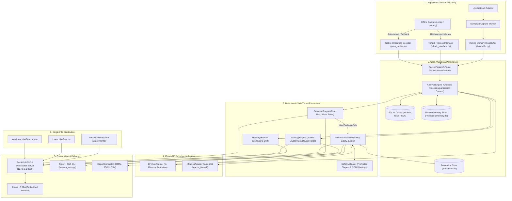

# Beacon — Cybersecurity Network Traffic Investigation Platform

<p align="center">
  
</p>

<p align="center">
  <strong>Transform raw network packet captures into actionable security intelligence.</strong><br>
  <em>Wireshark shows packets. Beacon helps you understand what deserves attention.</em>
</p>

<p align="center">
  
  
  
  
  
  
</p>

---

## Table of Contents
1. [Overview](#1-overview)
2. [Verified Current Features](#2-verified-current-features)
3. [System Architecture](#3-system-architecture)
4. [User Interface & Investigation Views](#4-user-interface--investigation-views)
5. [Prerequisites & Supported Platforms](#5-prerequisites--supported-platforms)
6. [Installation & Development Setup](#6-installation--development-setup)
7. [Command-Line Interface (CLI) Reference](#7-command-line-interface-cli-reference)
8. [Live Capture & Operating System Privileges](#8-live-capture--operating-system-privileges)
9. [Threat Prevention & Network Blocking Subsystem](#9-threat-prevention--network-blocking-subsystem)
10. [Network Access, Authentication & Hardening](#10-network-access-authentication--hardening)
11. [Packaging & Standalone Releases](#11-packaging--standalone-releases)
12. [Testing & Verification](#12-testing--verification)
13. [Future Roadmap & Network Sensor Direction](#13-future-roadmap--network-sensor-direction)
14. [Platform Compatibility & Known Limitations](#14-platform-compatibility--known-limitations)
15. [Security, Responsible Use & License](#15-security-responsible-use--license)

---

## 1. Overview

### What is Beacon?
**Beacon** is an open, local-first cybersecurity network investigation and traffic analysis platform. It consumes standard raw network packet captures (`.pcap`, `.pcapng`) and continuous live network interface streams, decodes bidirectional communication sessions, evaluates deterministic heuristic security rules, and presents findings across an interactive terminal CLI and a modern cyber-workstation web dashboard.

### What Problem Does Beacon Solve?
Analyzing multi-gigabyte packet captures in traditional packet sniffers requires manually configuring complex Wireshark display filters (`tcp.flags.syn == 1 && tcp.flags.ack == 0`, `http.request.method == "POST"`, `tls.handshake.extensions_server_name`). Security analysts must mentally correlate IP addresses, reconstruct TCP streams, distinguish internal subnets from public cloud infrastructure, and track behavioral drift over time.

Beacon automates this investigative triage:
- **Session Aggregation**: Reconstructs raw packets into bidirectional 5-tuple socket conversations.
- **Topological Inference**: Infers private LAN CIDR boundaries, gateway roles, server endpoints, and external WAN destinations.
- **Threat Detection**: Flags high-risk patterns including port scans, cleartext credentials, beaconing regularities, and DNS tunneling.
- **Historical Memory**: Maintains baseline profiles across capture sessions to identify first-seen communication channels and volumetric anomalies.
- **Safe Threat Prevention**: Provides operator-controlled, temporary destination-IP blocking with safety constraints, independent state verification, and audit logging.

### How Beacon Complements Wireshark and TShark
Beacon is **not** a replacement for Wireshark or TShark. Instead, it serves as a higher-level triage and correlation layer:
- **TShark / Wireshark**: Dissects thousands of low-level protocol fields at the microsecond wire level.
- **Beacon**: Ingests packets (using built-in zero-dependency native decoders or TShark), aggregates communication flows, identifies security observations, and links every finding directly to the exact packet numbers requiring deep forensic inspection.

---

## 2. Verified Current Features

All capabilities documented in this section have been verified in the actual codebase and validated by automated tests:

### A. Offline PCAP & PCAPNG Ingestion
- **Microsecond & Nanosecond Timestamps**: Decodes classic PCAP format (`.pcap`) and Next-Generation PCAPNG (`.pcapng`).
- **PCAPNG Block Parsing**: Supports Section Header Blocks (SHB), Interface Description Blocks (IDB), Enhanced Packet Blocks (EPB), and Simple Packet Blocks (SPB).
- **Dual-Engine Architecture**:
  - **Hardware Accelerator**: Uses `tshark` subprocesses for accelerated dissection when Wireshark is installed.
  - **Zero-Dependency Fallback**: Transparently activates [`pcap_native.py`](file:///D:/Project/Becon-claude/beacon/core/pcap_native.py) when TShark is absent. Decodes Ethernet, IPv4, IPv6, TCP, UDP, DNS queries, HTTP verbs/URIs, and TLS Server Name Indication (SNI) using pure Python.

### B. Investigation Views & Analytics
- **Host Inventory (`/hosts`)**: Aggregates byte counts, packet volumes, internal/external ratios, and active protocol sets per IP.
- **Bidirectional Conversations (`/conversations`)**: 5-tuple socket hashing (`ip_src:port` $\leftrightarrow$ `ip_dst:port`), tracking session duration, byte transfer volume, and packet sequences.
- **Chronological Timeline (`/timeline`)**: Chronologically orders TCP handshakes, DNS resolutions, HTTP requests, and TLS negotiations.
- **Security Findings (`/findings`)**: Ranked findings with severity (`Critical`, `High`, `Medium`, `Low`, `Info`), confidence ratings (`High`, `Medium`, `Low`), and direct packet citations.
- **Indicators of Interest (`/iocs`)**: Automatically extracts and indexes observed IP addresses, domains, URLs, and file hashes.
- **Deep Packet Inspector (`/packets`)**: Inspects packet metadata, protocol layer hierarchies, payload sizes, and hex representations.
- **Capture Comparison (`/compare`)**: Side-by-side comparative analysis contrasting novel hosts, ports, and protocols between separate capture files.

### C. Heuristic Security Modes
- **Blue Mode (Defensive Response)**: Identifies reconnaissance sweeps, SYN port scans, C2 beacon intervals, abnormal outbound volume surges, and suspicious DNS activity.
- **Red Mode (Exposure & Leakage)**: Highlights cleartext passwords, session tokens/cookies, internal IP disclosure, and server software banner leaks.
- **White Mode (Neutral Baseline)**: Provides statistical protocol and communication distributions without opinionated alerting.
- **Free Bird Mode (Dual Identity)**: Combines defensive threat detection and offensive exposure auditing in a unified workstation view.

### D. Interactive Network Topology Graph
- **Heuristic Subnet Clustering**: Groups observed private IPv4/IPv6 addresses into logical CIDR prefix containers (`192.168.1.0/24`, `10.0.0.0/24`).
- **Device Role Inference**: Assigns distinct visual badges for Gateways `[GW]`, Servers `[SRV]`, Clients `[CLI]`, and External WAN destinations `[EXT]`.
- **Synchronous Container Dragging**: Dragging a subnet container moves the group boundary, internal host nodes, role badges, and connection edges together without breaking layout geometry.

### E. Beacon Memory (Historical Baselines)
- **Persistent Local Baseline**: SQLite store (`~/.beacon/memory.db`) tracks historical hosts, conversations, and protocol baselines.
- **Behavioral Drift Detection**: Flags first-seen external destinations, unexpected internal communication channels, and recurring anomalies across 7, 30, and 90-day intervals.
- **Analyst Feedback Loop**: Operators can mark findings as expected or benign to train local baseline models.

### F. Continuous Live Capture & Smart Retention
- **In-Memory Rolling Ring Buffer**: FIFO packet buffer with bounded memory limits (configurable from 500 to 2,000 packets) designed for low-resource environments.
- **Smart Evidence Retention**: Automatically captures pre-trigger context and post-trigger packets when a security rule fires, preserving the incident to an immutable capture file.
- **Real-Time WebSocket Telemetry**: Streams live packet counters, active conversation flows, and incident alerts directly to the web client via `/ws/live`.

### G. Threat Prevention Subsystem
- **Modular Architecture**: Clean separation between policy evaluation, target validation, persistence, and firewall adapters.
- **Default Policy (Monitor Only)**: Passive monitoring by default; firewall rules are never created without operator configuration.
- **Human-in-the-Loop Mode (Ask Before Blocking)**: Security findings queue proposed blocks as `PENDING_APPROVAL` for explicit operator review.
- **Opt-In Automatic Protection**: Autonomous blocking requires explicit operator opt-in, `HIGH` detection confidence, an active supported adapter, bounded capacity, and rate limit validation.
- **Destination IP Targeting Only**: Blocks target suspicious external destination IPs only; source addresses and local LANs are never blocked.
- **Temporary Blocks with Automatic Expiry**: 15-minute default block duration (configurable from 10s to 86,400s) with a background worker that automatically removes expired rules.
- **Startup Reconciliation**: On launch, expired rules are pruned and valid unexpired rules are restored to the firewall adapter.
- **Independent State Verification & Immediate Rollback**: After rule application, the firewall state is queried independently; verification failures trigger an immediate rollback and status is marked `FAILED`.
- **Target Safety Constraints**: Prohibits blocking loopback (`127.0.0.0/8`, `::1`), unspecified (`0.0.0.0`), broadcast (`255.255.255.255`), multicast (`224.0.0.0/4`), link-local (`169.254.0.0/16`), default gateways, and allowlisted subnets.
- **Multi-Tenant / CDN Collateral Warning**: Detects destination addresses belonging to shared hyperscaler and CDN ranges (Cloudflare, Google, AWS CloudFront, Fastly, Akamai, Quad9) and attaches explicit cautionary warnings.
- **Persistent Audit Trail**: SQLite store (`prevention.db`) records all safety checks, rule creations, approvals, revocations, and verification results.

### H. Reports & Exports
- **Executive HTML Report**: Self-contained visual report with summary charts, top findings, and packet citations.
- **Structured JSON Export**: Complete machine-readable investigation dump.
- **CSV Summaries**: Tabular findings and host inventories for spreadsheet analysis.

---

## 3. System Architecture

The Beacon architecture enforces strict separation between packet decoding, heuristic analysis, presentation, and enforcement:



---

## 4. User Interface & Investigation Views

Beacon features a custom dark cyber-workstation interface built with React 18, Tailwind CSS, and Lucide Icons:

```text
+---------------------------------------------------------------------------------------+
| BEACON // CYBERSECURITY NETWORK INVESTIGATION PLATFORM       [MODE: BLUE]  [PIN: ***]  |
+-------------------+-------------------------------------------------------------------+
| [=] Dashboard     | PACKETS: 17       HOSTS: 4       DURATION: 2.27s     DROPS: 0     |
| [o] Network Graph | PROTOCOLS: TCP (12), DNS (1), HTTP (1), SSH (1), OTHER (2)        |
| [#] Hosts         +-------------------------------------------------------------------+
| [<>] Conversations| TOPOLOGICAL NETWORK MAP:                                          |
| [!] Findings (1)  |   +-- 192.168.1.0/24 ------------------------------------------+  |
| [@] IOCs          |   |   (CLI) 192.168.1.100 ---------> [GW] 192.168.1.1          |  |
| [~] Timeline      |   +------------------------------------|-----------------------+  |
| [?] Packets       |                                        v                          |
| [*] Live Capture  |                          [EXT] 93.184.216.34 (example.com)        |
| [M] Memory        +-------------------------------------------------------------------+
| [/] Compare       | FINDINGS: [HIGH] Port Scanning Activity from 192.168.1.100        |
| [!] Threat Prev.  | PREVENTION: Mode: MONITOR | Active: 0 | Auto: OFF | Dry-Run Ready |
+-------------------+-------------------------------------------------------------------+
```

### Verified Interface Views:
1. **Executive Dashboard**: Key network indicators, bandwidth rates, protocol distributions, and prioritized finding lists.
2. **Network Graph**: Interactive topology canvas with draggable subnet containers, device role icons, and bidirectional traffic edges.
3. **Host Inventory**: Sortable host catalog tracking inward/outward bytes, packets, and active application protocols.
4. **Conversations View**: 5-tuple socket communication table with payload volume and packet metrics.
5. **Security Findings Feed**: Categorized findings with severity/confidence pills, detection rationale, and cited packet numbers.
6. **Chronological Timeline**: Visual event timeline mapping DNS queries, handshakes, HTTP transactions, and alerts.
7. **Packet Explorer**: Hex viewer, protocol hierarchy tree, and raw frame inspector.
8. **Live Capture Center**: Real-time packet streamer, buffer occupancy gauges, and preserved incident manager.
9. **Beacon Memory**: Historical baseline drift comparison highlighting novel external destinations.
10. **Threat Prevention Panel**: Policy mode selector, auto-protect opt-in modal, manual block form, active rules table with live countdowns, pending approvals queue, and persistent audit log.

---

## 5. Prerequisites & Supported Platforms

### For Standalone Executables (`dist/Beacon.exe`, `dist/Beacon`)
- **Python**: **Not required** (embedded inside executable).
- **Node.js**: **Not required** (React production assets bundled directly).
- **Virtual Environments**: **Not required**.
- **External Dependencies**: **Zero required** for offline `.pcap` and `.pcapng` file analysis.

### For Development from Source
- **Python**: Version 3.10, 3.11, 3.12, or 3.13 (64-bit).
- **Node.js & npm**: Node.js 18+ and npm 9+ (required only when modifying or compiling `web/`).
- **Build Tools**: A C compiler is **not** required when installing from wheels (NumPy 2.x and Pandas provide pre-compiled wheels for Python 3.10–3.13).

### Optional Accelerators & Live Capture Drivers
- **TShark / Wireshark**: Optional hardware accelerator for packet decoding. If absent, Beacon uses its built-in native streaming decoder.
- **Packet Capture Drivers for Live Traffic**:
  - **Windows**: Requires [Npcap](https://npcap.com/#download) (installed with Wireshark).
  - **Linux**: Requires `dumpcap` capabilities or membership in the `wireshark` group.
  - **macOS**: Requires read/write access to Berkeley Packet Filter devices (`/dev/bpf*`).

---

## 6. Installation & Development Setup

### A. Clone Repository
```bash
git clone https://github.com/your-org/beacon.git
cd beacon
```

### B. Python Virtual Environment Setup

#### Linux / macOS
```bash
python3 -m venv .venv
source .venv/bin/activate
pip install --upgrade pip setuptools wheel
pip install -r requirements.txt
pip install -e .
```

#### Windows (PowerShell)
```powershell
python -m venv .venv
.\.venv\Scripts\Activate.ps1
pip install --upgrade pip setuptools wheel
pip install -r requirements.txt
pip install -e .
```

### C. Frontend Compilation (React 18 SPA)
To build production web assets embedded into the executable:
```bash
cd web
npm install
npm run build
cd ..
```
Compiled assets are output to `web/dist/index.html` and `web/dist/assets/`.

---

## 7. Command-Line Interface (CLI) Reference

The Beacon CLI provides direct terminal access to all analysis, capture, memory, and prevention features:

### General & Environment
```bash
# General help menu
python -m beacon --help

# Version and environment diagnostics
python -m beacon version-info
```

### Offline PCAP Analysis
```bash
# Analyze capture in Blue Mode (defensive)
python -m beacon analyze capture.pcap --mode blue

# Analyze capture in Red Mode (credential & leak auditing)
python -m beacon analyze capture.pcap --mode red

# Analyze capture in White Mode (neutral baseline)
python -m beacon analyze capture.pcap --mode white

# Limit packet processing and export findings to JSON
python -m beacon analyze capture.pcap --mode blue --limit 5000 --output findings.json

# Index capture into Beacon Memory for baseline comparison
python -m beacon analyze capture.pcap --mode blue --memory

# Display capture file metadata
python -m beacon info capture.pcap
```

### Traffic & Forensic Inspection
```bash
# List top 20 communicating hosts
python -m beacon hosts capture.pcap --top 20

# Filter hosts by direction (inbound, outbound, lateral)
python -m beacon hosts capture.pcap --direction outbound

# Display bidirectional session conversations
python -m beacon conversations capture.pcap --top 25

# Display security findings
python -m beacon findings capture.pcap --severity high --verbose

# Extract observed Indicators of Compromise (IOCs)
python -m beacon ioc capture.pcap --export iocs.json

# Protocol breakdown
python -m beacon protocols capture.pcap --dns
python -m beacon protocols capture.pcap --http
python -m beacon protocols capture.pcap --tls

# Inspect a specific packet frame by number
python -m beacon packet capture.pcap 42

# Chronological event timeline
python -m beacon timeline capture.pcap --limit 200
```

### Reports & Exports
```bash
# Generate executive HTML investigation report
python -m beacon report capture.pcap --format html --output report.html

# Export structured JSON data or CSV findings
python -m beacon report capture.pcap --format json --output report.json
python -m beacon report capture.pcap --format csv --output findings.csv
```

### Beacon Memory (Historical Baselines)
```bash
# Check baseline memory coverage
python -m beacon memory status

# Show behavioral changes across the past 7 days
python -m beacon memory changes --days 7

# Display executive change briefing
python -m beacon memory briefing
```

### Continuous Live Capture
```bash
# List available network interfaces
python -m beacon live interfaces

# Start continuous live capture in Blue Mode
python -m beacon live start --interface eth0 --mode blue

# Check active live capture status
python -m beacon live status

# Review preserved incident captures
python -m beacon live incidents

# Stop live capture
python -m beacon live stop
```

### Threat Prevention Controls
```bash
# View threat prevention engine status, mode, and active rule count
python -m beacon prevention status

# List active and pending threat block rules
python -m beacon prevention list

# Manually block a suspicious destination IP for 10 minutes (600s)
python -m beacon prevention block 198.51.100.42 --duration 600 --reason "Observed C2 traffic"

# Approve a pending block rule proposed by a security finding
python -m beacon prevention approve <rule-id>

# Revoke an active block rule
python -m beacon prevention revoke <rule-id> --reason "False positive confirmed"

# Inspect or update prevention policy mode
python -m beacon prevention policy --mode ask

# View prevention audit trail
python -m beacon prevention audit --limit 25
```

### Launching the Web Server & Dashboard
```bash
# Start local investigation server and open default browser automatically
python -m beacon launch

# Start headless server on custom port
python -m beacon launch --port 8080 --no-browser

# Start server for LAN access protected by an access PIN
python -m beacon serve --host 0.0.0.0 --port 8000 --pin 849201
```

---

## 8. Live Capture & Operating System Privileges

Beacon operates with an in-memory rolling ring buffer (default: 500 packets in low-resource mode, up to 2,000 packets) for continuous monitoring. When a security finding fires, surrounding packets are preserved in an immutable capture file.

### Linux (Debian, Ubuntu, antiX)
> [!IMPORTANT]
> **Do not run the Beacon application as `root`.** Beacon uses Linux capability delegation.

1. Ensure capture utilities are installed:
   ```bash
   sudo apt install -y tshark wireshark-common libcap2-bin
   ```
2. Enable non-root packet capture:
   ```bash
   sudo dpkg-reconfigure wireshark-common
   # Select <Yes> when prompted
   ```
3. Add your user account to the `wireshark` group:
   ```bash
   sudo usermod -aG wireshark $USER
   newgrp wireshark
   ```
4. Verify unprivileged capture access:
   ```bash
   dumpcap -D
   ```

### Windows
- Live capture requires the **Npcap** packet capture driver.
- Download and install Wireshark from [wireshark.org](https://www.wireshark.org/) with the "Install Npcap" option checked.
- If Npcap is absent, Beacon's offline `.pcap` analysis remains fully operational.

### macOS
- Live capture requires read/write access to Berkeley Packet Filter devices (`/dev/bpf*`).
- Installing Wireshark via Homebrew (`brew install --cask wireshark`) configures the `ChmodBPF` daemon for unprivileged capture on boot.

---

## 9. Threat Prevention & Network Blocking Subsystem

Beacon includes a safe, modular threat prevention engine designed to mitigate risks without disrupting valid traffic:

### Enforcement Modes
1. **Monitor Only (Default)**: Passive detection. Findings are logged and flagged, but no firewall commands are executed.
2. **Ask Before Blocking**: When a live detection fires, the engine creates a `PENDING_APPROVAL` rule. The block takes effect only when an operator explicitly approves it via the UI or CLI.
3. **Automatic Protection (Opt-In Only)**: Automatically applies temporary drop rules for qualified findings. Requires:
   - Explicit operator opt-in (`auto_protect_enabled = True`).
   - `HIGH` detection confidence.
   - An active and supported firewall adapter.
   - Target safety check passage.
   - Capacity within bounded active rule limits (default: 100 max).
   - Rate limit compliance (maximum 10 blocks/minute sliding window).

### Target Safety Constraints
To avoid denial-of-service against the host or local network, Beacon rejects blocks targeting:
- **Loopback**: `127.0.0.0/8`, `::1`
- **Unspecified**: `0.0.0.0`, `::`
- **Broadcast**: `255.255.255.255`
- **Multicast**: `224.0.0.0/4`, `ff00::/8`
- **Link-Local**: `169.254.0.0/16`, `fe80::/10`
- **Critical Infrastructure**: Default gateways, local DNS resolvers.
- **Configured Allowlists**: User-specified IPs and CIDR subnets.

### Multi-Tenant & CDN Collateral Impact Warnings
Blocking an IP address hosted on shared infrastructure can disrupt unrelated services. Beacon detects IPs belonging to major CDN and cloud providers (Cloudflare, Google, AWS CloudFront, Fastly, Akamai, Quad9) and attaches an explicit cautionary warning to the rule in the UI and audit log.

### Independent State Verification & Rollback
Beacon never assumes a firewall command succeeded:
1. The rule is injected via the active adapter.
2. The firewall adapter is queried independently to verify rule presence.
3. If verification fails, Beacon executes an immediate rollback, marks the rule status as `FAILED`, and records a `VERIFICATION_FAILED_ROLLBACK` event in the audit trail.

### Temporary Expiry & Startup Reconciliation
- **Default TTL**: All rules carry a 15-minute default duration (configurable between 10s and 24h).
- **Background Worker**: Sweeps active rules every 5 seconds and releases expired blocks.
- **Startup Reconciliation**: On engine startup, rules that expired while the system was offline are purged, and unexpired rules are re-verified and restored to the adapter.

### Firewall Adapters
- **`DryRunAdapter`**: In-memory simulation adapter for testing, development, and non-Linux systems. Modifies zero host firewall state.
- **`NftablesAdapter` (Linux)**: Strictly manages an isolated table (`table inet beacon_firewall`) and set (`set beacon_blocked_dest`). It deletes only its own table and never flushes or modifies unrelated system chains.

---

## 10. Network Access, Authentication & Hardening

### Loopback Binding by Default
Beacon binds to `127.0.0.1:8000` by default. It does not open ports to the local network or the internet automatically.

### Enabling Remote LAN Access
To allow access from another device on your local network:
```bash
beacon serve --host 0.0.0.0 --port 8000 --pin <secret-pin>
```

### Access PIN Authentication Scope
When `--pin` (or environment variable `BEACON_PIN`) is set:
- **Protected Endpoints**: Capture controls, uploads, configuration changes, prevention policies, manual blocks, and data exports require the `X-Beacon-PIN` HTTP header.
- **Brute-Force Rate Limiting**: Verification endpoints enforce sliding-window attempt throttling to protect against brute-force attacks.
- **Cleartext HTTP Warning**: The access PIN provides authorization for local coordination; it does **not** provide cryptographic transport encryption. When accessed over cleartext Wi-Fi, HTTP traffic can be intercepted.
- **Recommended Hardening**: When accessing Beacon across untrusted networks, terminate traffic behind a reverse proxy with TLS (such as Caddy or Nginx) or access it over a secure VPN (WireGuard or Tailscale).

---

## 11. Packaging & Standalone Releases

Beacon provides automated packaging pipelines producing single-file distributable releases:

### Building Releases

#### Windows Single-EXE (`dist/Beacon.exe`)
```cmd
scripts\build_windows.bat
```
- **Output**: `dist\Beacon.exe` (~37.8 MB).
- **Verified Environment**: Windows 11 64-bit with Python 3.12.
- **Experience**: Double-click `Beacon.exe`. The server starts, and your default web browser opens the dashboard automatically.

#### Linux Single-File Binary (`dist/Beacon`)
```bash
bash scripts/build_linux.sh
```
- **Output**: `dist/Beacon` (~28.8 MB).
- **Verified Environments**: antiX Linux / Debian, Ubuntu 26.04 LTS (x86_64).
- **Experience**: Run `./dist/Beacon` to start the server and open the web UI.

#### macOS Single Binary & App Bundle (`dist/Beacon.app`)
```bash
bash scripts/build_macos.sh
```
- **Output**: Standalone CLI binary `dist/Beacon` and application bundle `dist/Beacon.app`.
- **Status**: Build scripts and PyInstaller specification are implemented; runtime execution is currently marked as **Experimental / Untested** due to the absence of physical macOS hardware in the test environment.

### Automated Release Verification Suite
Verify compiled release artifacts from an independent working directory:
```bash
python scripts/verify_release.py dist/Beacon.exe
```
This suite validates:
1. CLI `--version` and `--help` outside the repository.
2. PCAP analysis using sample test fixtures.
3. Server startup on loopback port 8999.
4. Readiness probe on `/api/health`.
5. REST endpoints (`/api/live/status`, `/api/analyses`).
6. Production React SPA serving from root (`/`).
7. Static CSS/JS asset delivery.
8. WebSocket handshake on `/ws/live` (`101 Switching Protocols`).
9. Clean process termination and port release.

---

## 12. Testing & Verification

Beacon maintains an automated regression test suite covering core parsers, detection rules, live ring buffers, memory baselines, threat prevention, and platform compatibility:

```bash
# Run full test suite
pytest

# Run tests with concise summary
pytest -q

# Run specific functional suites
pytest tests/test_core.py
pytest tests/test_topology.py
pytest tests/test_live.py
pytest tests/test_memory.py
pytest tests/test_prevention.py
pytest tests/test_remote_low_resource.py
```

### Verified Test Status:
- **Total Tests**: **157 passed** (0 failures, 0 errors).
- **Execution Time**: ~8.2 seconds.
- **Pre-Release Check**: Run `python scripts/verify_setup.py` to confirm module imports, TShark availability, and detection engine readiness.

---

## 13. Future Roadmap & Network Sensor Direction

> [!NOTE]
> This section describes **planned future capabilities**, distinguished from the implemented and tested functionality documented above.

### Intended Product Direction: Self-Hosted Network Security Sensor
The long-term vision for Beacon is to evolve into a lightweight, self-hosted network security sensor capable of running on low-resource hardware (such as a Raspberry Pi or small Linux appliance) to protect home and small-office networks.

### Planned Capabilities:
1. **Continuous Low-Resource Monitoring**: Dedicated background daemon optimized for minimal CPU and RAM usage on SBC platforms (Raspberry Pi 4/5).
2. **Router-Agnostic Capture Integrations**:
   - Ingestion of NetFlow, IPFIX, and sFlow data exported by compatible routers.
   - Integration with OpenWrt, pfSense, and OPNsense flow sensors.
3. **Managed-Switch Port Mirroring (SPAN)**: Guidance and templates for monitoring entire network segments via managed switch mirror ports.
4. **Router-Side Capture Agents**: Lightweight capture agents for deployment directly on supported open-source router firmware.
5. **Network Inventory & Device Discovery**: Automated discovery of new devices, MAC vendors, and hostname mappings over time.
6. **Configurable Evidence Retention**: Retention policies governing how many incident PCAPs are retained on local storage before FIFO pruning.
7. **Sensor Health & Alerting**: System temperature, memory occupancy, dropped packet monitoring, and outbound webhook alerts (Slack, Discord, Syslog).
8. **Remote Multi-Sensor Dashboard**: Centralized investigation dashboard aggregating findings across multiple distributed Beacon sensors.

### Crucial Network Topology Clarification
> [!WARNING]
> **Connecting a monitoring device to an ordinary router Ethernet switch port does NOT automatically provide visibility into all network traffic.**
>
> Standard Ethernet switches forward unicast packets **only** to the specific switch port where the destination MAC address resides. Broadcast and multicast traffic are visible to all ports, but unicast conversations between other network hosts and the internet will not reach the sensor.
>
> **Full network visibility requires one of the following deployment topologies:**
> - **Managed Switch Port Mirroring (SPAN)**: Configuring a managed switch to mirror all VLAN or port traffic to the sensor's physical port.
> - **Hardware Network TAP**: Placing a physical test access point between the router and the main switch.
> - **Dual-NIC Inline Bridge**: Deploying the sensor with two network cards configured as a transparent network bridge.
> - **Router-Level Capture**: Running packet capture or flow export directly on the router/gateway (e.g. OpenWrt, pfSense).

### Planned Threat Prevention Evolution
- Maintain the strict **Monitor Only by default** policy across all sensor deployments.
- Require operator sign-off for proposed blocks by default (**Ask Before Blocking**).
- Enable **Automatic Protection** only through deliberate operator action.
- Retain destination-only temporary blocks with validation, expiration timers, audit logs, and one-click revocation.

---

## 14. Platform Compatibility & Known Limitations

| Operating System | Offline PCAP Analysis | Live Capture | Threat Prevention | Standalone Executable | Status |
| :--- | :---: | :---: | :---: | :---: | :--- |
| **Windows 10 / 11 (x64)** | **Verified** | **Verified** (with Npcap) | **Verified** (Dry-Run) | **Verified** (`dist/Beacon.exe`) | **Fully Supported** |
| **Linux (Debian, Ubuntu, antiX)** | **Verified** | **Verified** (`dumpcap`) | **Verified** (Dry-Run & `nftables` unit tests) | **Verified** (`dist/Beacon`) | **Fully Supported** |
| **macOS (Intel & Apple Silicon)** | **Verified** (source) | **Requires BPF permissions** | **Dry-Run only** | Build script ready; runtime unverified | **Experimental / Untested** |
| **Raspberry Pi OS (ARM64)** | **Planned** | **Planned** | **Planned** | Not yet packaged | **Planned Roadmap** |

### Known Limitations Disclosed:
- **macOS Binary**: While `scripts/build_macos.sh` is implemented, compiled macOS binaries have not been validated on physical Apple hardware in this test environment.
- **Linux Active Firewall Enforcement**: The `NftablesAdapter` is unit-tested for syntax, isolated table construction, and dry-run fallback. Active kernel table manipulation in a production Linux environment requires `CAP_NET_ADMIN` or root privileges.
- **Single-User Access Model**: Beacon uses a shared access PIN for local network access control. Multi-tenant enterprise RBAC is not currently implemented.
- **Encrypted Payload Decryption**: Beacon inspects TLS handshakes and Server Name Indication (SNI), but does not decrypt encrypted session payloads without external pre-master secrets (`SSLKEYLOGFILE`).

---

## 15. Security, Responsible Use & License

### Responsible Use & Authorization
Beacon is developed for **authorized cybersecurity investigations, defensive network monitoring, educational research, and incident response**. Never capture or inspect network traffic on networks without explicit, written authorization from the network owner.

### Privacy & Data Integrity
- **Local-First Architecture**: Beacon runs entirely on your local machine. Captured packets, forensic findings, and network metadata are **never** transmitted to external cloud servers or telemetry systems.
- **Credential Redaction**: Passwords, authorization tokens, bearer keys, and sensitive session cookies are masked as `[REDACTED]` across UI views, API responses, and generated reports.
- **Defensive Parser Design**: Packet demuxing enforces boundary checks and chunked ingestion to prevent memory exhaustion from malformed or maliciously crafted capture files.

### License Status
> [!NOTE]
> **No formal open-source license has been assigned to this repository yet.** All rights are currently reserved by the original project authors. Prior to public redistribution or commercial deployment, selecting an appropriate permissive license (such as the **MIT License** or **Apache License 2.0**) is recommended.

### Acknowledgments
Beacon builds upon and acknowledges:
- **The Wireshark & TShark Project** ([wireshark.org](https://www.wireshark.org/)) for industry-standard packet dissection.
- **FastAPI** by Sebastián Ramírez for modern asynchronous backend APIs.
- **React & Vite** for responsive single-page application development.
- **Lucide Icons** for clean security iconography.
