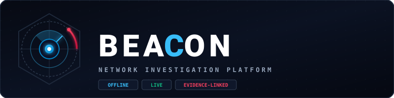
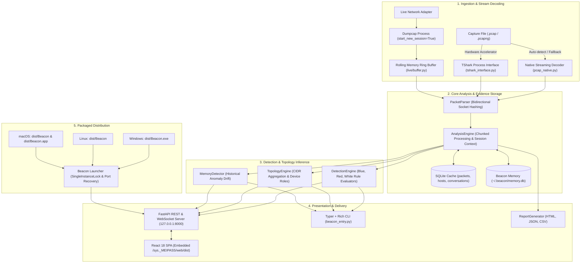

# Beacon — Cybersecurity Network Traffic Investigation Platform

<p align="center">
  
</p>

<p align="center">
  <strong>Transform raw network packet captures into actionable security intelligence.</strong><br>
  <em>Wireshark shows packets. Beacon helps you understand what deserves attention.</em>
</p>

<p align="center">
  
  
  
  
  
  
</p>

---

## Section A: Project Introduction

### What is Beacon?
**Beacon** is an open, local-first cybersecurity network investigation platform. It consumes standard raw network packet captures (`.pcap`, `.pcapng`) and continuous live network interface traffic, decodes the underlying communication sessions, evaluates deterministic heuristic security rules, and presents the results across an interactive terminal interface and a modern hacker-workstation web dashboard.

### What Problem Does Beacon Solve?
Analyzing multi-gigabyte packet captures in traditional packet sniffers often requires manually configuring dozens of complex Wireshark display filters (`tcp.flags.syn == 1 && tcp.flags.ack == 0`, `http.request.method == "POST"`, `tls.handshake.extensions_server_name`). Analysts must mentally correlate IP addresses, reconstruct TCP streams, distinguish internal subnets from public cloud infrastructure, and track behavioral drift over time.

Beacon automates this investigative triage:
- It normalizes raw packets into bidirectional socket conversations.
- It automatically infers private LAN CIDR boundaries, gateway roles, server endpoints, and external WAN destinations.
- It highlights high-risk events (port scanning, cleartext credential leakage, DNS tunneling, beaconing intervals).
- It provides historical baseline memory across capture sessions to identify novel communication channels.

### Who is Beacon For?
- **Security Operations Center (SOC) Analysts & Incident Responders:** Rapidly triage anomalous PCAP dumps from perimeter alerts without opening gigabyte-sized files packet-by-packet.
- **Penetration Testers & Red Teams:** Audit egress leakage, cleartext passwords, and reconnaissance footprints.
- **Network Engineers & Sysadmins:** Visualize active subnet topologies, diagnose chatty hosts, and isolate connection failures.
- **Cybersecurity Students & Educators:** Learn protocol dissection, packet inspection, and threat detection on an explainable, visual platform.

### How Beacon Complements Wireshark and TShark
Beacon is **not** a replacement for Wireshark or TShark. Instead, it serves as a higher-level investigative layer:
- **TShark / Wireshark**: Dissects thousands of low-level protocol fields at the microsecond wire level.
- **Beacon**: Ingests packets (via built-in zero-dependency native decoders or TShark), aggregates communication flows, identifies security observations, and directs the investigator to the exact packets that require low-level verification.

---

## Section B: Feature Inventory & Implementation Status

Beacon strictly distinguishes between verified, tested features and platform-specific capabilities:

| Feature Area | Specific Capability | Implementation Status | Verification Details |
| :--- | :--- | :---: | :--- |
| **PCAP & PCAPNG Ingestion** | Microsecond & nanosecond PCAP decoding | **Implemented & Tested** | Verified with `pcap_native.py` and TShark on sample captures. |
| | Next-Gen PCAPNG (SHB, IDB, EPB, SPB) | **Implemented & Tested** | Tested against multi-interface captures and big/little endian headers. |
| | Zero-dependency pure-Python fallback | **Implemented & Tested** | Decodes Ethernet, IPv4, IPv6, TCP, UDP, DNS, HTTP, TLS SNI without Wireshark. |
| **Investigation Views** | Host Inventory (`/hosts`) | **Implemented & Tested** | Aggregates bytes, packets, internal/external ratios, active protocols. |
| | Bidirectional Conversations (`/conversations`) | **Implemented & Tested** | 5-tuple socket hashing, duration, byte volume, packet counts. |
| | Event Timeline (`/timeline`) | **Implemented & Tested** | Chronological ordering of handshakes, DNS queries, HTTP verbs, TLS SNI. |
| | Security Findings (`/findings`) | **Implemented & Tested** | Ranked findings with severity (`Critical`, `High`, `Med`, `Low`, `Info`) & packet citations. |
| | Protocol Distribution (`/protocols`) | **Implemented & Tested** | Breakdowns for transport and application layers (HTTP, DNS, TLS). |
| | Indicators of Interest (`/iocs`) | **Implemented & Tested** | Regex & parser extraction of IPs, domains, URLs, file hashes. |
| | Deep Packet Inspector (`/packet`) | **Implemented & Tested** | Dissects raw byte offsets, protocol layers, hex representations. |
| | Capture Comparison (`/compare`) | **Implemented & Tested** | Side-by-side diff comparing novel hosts, ports, and protocols between PCAPs. |
| **Security Analysis Modes** | **Blue Mode** (Defensive Response) | **Implemented & Tested** | Port scans, host sweeps, C2 beacon intervals, exfiltration volume, DNS tunnels. |
| | **Red Mode** (Exposure & Leakage) | **Implemented & Tested** | Cleartext passwords, session cookies, internal IP disclosure, software version leaks. |
| | **White Mode** (Neutral Baseline) | **Implemented & Tested** | Statistical traffic distributions without opinionated alerting. |
| | **Free Bird Mode** (Dual Identity) | **Implemented & Tested** | Combined defensive and offensive telemetry in a unified workstation view. |
| **Network Graph** | Topological Subnet Inference | **Implemented & Tested** | Heuristic IPv4/IPv6 CIDR prefix grouping (`192.168.1.0/24`, `10.0.0.0/24`). |
| | Device Role Badging | **Implemented & Tested** | Distinct node shapes for Gateways `[GW]`, Servers `[SRV]`, Clients `[CLI]`, External `[EXT]`. |
| | Draggable Subnet Containers | **Implemented & Tested** | Moving a subnet group boundary moves all child nodes and labels synchronously. |
| **Beacon Memory** | Local Baseline Storage | **Implemented & Tested** | SQLite-backed database (`~/.beacon/memory.db`) storing historical entities. |
| | Behavioral Drift Detection | **Implemented & Tested** | Flags novel external destinations, unexpected internal shifts, recurring anomalies. |
| | Analyst Feedback Loop | **Implemented & Tested** | Mark findings as expected/benign to train local baseline models. |
| **Live Capture** | Continuous 24/7 Rolling Ring Buffer | **Implemented & Tested** | In-memory rolling packet buffer with bounded RAM limits (default: 500-2000 packets). |
| | Smart Evidence Retention | **Implemented & Tested** | Automatically preserves pre-roll and post-roll packet context on alert triggers. |
| | Real-Time WebSocket Telemetry | **Implemented & Tested** | Live packet counters, active flows, and incident broadcasts pushed to UI. |
| | OS Packet Capture Privileges | **Platform-Dependent** | Requires `dumpcap` capabilities/wireshark group on Linux, Npcap on Windows, BPF on macOS. |
| **Reporting** | Multi-Format Export | **Implemented & Tested** | Executive HTML report, structured JSON investigation dump, CSV findings list. |
| **Deployment** | Windows Single-File EXE | **Implemented & Tested** | Standalone `dist/Beacon.exe` (37.78 MB). Verified on Windows 11. |
| | Linux Single-File ELF | **Implemented & Tested** | Standalone `dist/Beacon` (28.85 MB). Verified on Debian/antiX and Ubuntu 26.04. |
| | macOS Single Binary & App Bundle | **Build Scripts Implemented** | `scripts/build_macos.sh` ready; runtime validation blocked (no macOS host). |
| | Multi-User Enterprise RBAC | **Planned / Unsupported** | Current implementation uses shared access PIN for local network coordination. |
| | Encrypted TLS Wire Decryption | **Planned / Unsupported** | Payload decryption requires external SSLKEYLOGFILE injection. |

---

## Section C: Architecture & Data Flow

Beacon is built on a modular pipeline where packet ingestion, stream decoding, heuristic rule evaluation, and presentation layers are strictly separated:



### Component Breakdown
1. **Streaming Demuxers**: Rather than reading multi-gigabyte captures entirely into memory, Beacon streams packets in chunks. If TShark is installed, Beacon uses it for accelerated dissecting. If TShark is not installed, Beacon seamlessly activates [`pcap_native.py`](file:///D:/Project/Becon-claude/beacon/core/pcap_native.py) to parse classic PCAP and Next-Gen PCAPNG files directly.
2. **Analysis Engine**: Normalizes packets into `ParsedPacket` structures with bidirectional socket hashes (`ip_src:port` $\leftrightarrow$ `ip_dst:port`) and commits session records into an indexing database.
3. **Detection Engine**: Evaluates deterministic security rules (TCP scan patterns, authentication credentials, beaconing regularities, domain generation heuristics).
4. **Topology Engine**: Clusters observed hosts into private LAN subnets and public external spaces, assigns node roles (`[GW]`, `[SRV]`, `[CLI]`, `[EXT]`), and computes coordinates for interactive SVG rendering.
5. **Beacon Memory**: A persistent local SQLite database tracking communication relationships over 7, 30, and 90-day baseline windows.
6. **FastAPI & React SPA**: Serves the single-page application and backend API from a single origin on `127.0.0.1:8000`, pushing live telemetry over WebSocket `/ws/live`.

---

## Section D: Visual Interface & Screenshots

### Interface Preview
The Beacon web dashboard uses a custom cyber-workstation dark aesthetic with variable security modes:

```text
+-----------------------------------------------------------------------------------+
| BEACON // CYBERSECURITY INVESTIGATION PLATFORM               [MODE: BLUE] [PIN: *] |
+------------------+----------------------------------------------------------------+
| [=] Dashboard    | TOTAL PACKETS: 17       UNIQUE HOSTS: 4       DURATION: 2.3s   |
| [o] Network Graph| TOP PROTOCOLS: TCP (12), DNS (1), HTTP (1), SSH (1)            |
| [#] Hosts        +----------------------------------------------------------------+
| [<>] Conversations| TOPOLOGICAL NETWORK MAP:                                       |
| [!] Findings (1) |  +-- 192.168.1.0/24 -----------------------------------------+  |
| [@] IOCs         |  |  (CLI) 192.168.1.100 ---------> [GW] 192.168.1.1          |  |
| [~] Timeline     |  +-----------------------------------|-----------------------+  |
| [?] Packets      |                                      v                          |
| [*] Live Capture |                        [EXT] 93.184.216.34 (example.com)       |
| [M] Memory       +----------------------------------------------------------------+
| [/] Compare      | FINDINGS: [MEDIUM] Port Scanning Detected from 192.168.1.100   |
+------------------+----------------------------------------------------------------+
```

### Screenshots Placeholder
The following verified screenshots will be captured and added to `docs/screenshots/` in the documentation repository:

- `docs/screenshots/01-dashboard.png`: Executive dashboard showing throughput, protocol breakdown, and findings feed.
- `docs/screenshots/02-network-graph.png`: Draggable subnet containers, role badges (`[GW]`, `[SRV]`, `[CLI]`), and interactive edges.
- `docs/screenshots/03-findings-detail.png`: Blue Mode alert detail with packet citations and confidence breakdown.
- `docs/screenshots/04-timeline.png`: Chronological timeline of DNS requests, TCP handshakes, and data transfers.
- `docs/screenshots/05-live-capture.png`: Live packet telemetry, rolling memory ring buffer, and retained incidents.

---

## Section E: System Prerequisites

### For Development (Building from Source)
- **Python**: Version 3.10, 3.11, 3.12, or 3.13 (64-bit recommended).
- **Node.js & npm**: Node.js 18+ and npm 9+ (only required if modifying or compiling the React frontend in `web/`).
- **Build Tools**: A C compiler is **not** required when installing from wheels (NumPy 2.x and Pandas 2.2.3+ provide pre-built wheels for Python 3.10–3.13).

### For Standalone Executable Releases (`dist/Beacon.exe`, `dist/Beacon`)
- **Python**: **Not required** (embedded inside executable).
- **Node.js**: **Not required** (React production assets bundled directly).
- **Virtual Environments**: **Not required**.
- **External Dependencies**: **Zero required** for offline `.pcap` and `.pcapng` file analysis.

### Optional External Hardware Accelerators & Live Capture
- **TShark / Wireshark (Optional)**: If installed, Beacon uses `tshark` for accelerated packet decoding. If absent, Beacon falls back to its built-in native engine.
- **Kernel Drivers for Live Packet Capture**:
  - **Windows**: Requires [Npcap](https://npcap.com/#download) (installed automatically with Wireshark).
  - **Linux**: Requires `dumpcap` packet capture capabilities or membership in the `wireshark` group.
  - **macOS**: Requires read/write access to Berkeley Packet Filter (`/dev/bpf*`) via Wireshark's ChmodBPF daemon.

---

## Section F: Installation & Development Setup

### A. Clone the Repository
```bash
git clone https://github.com/your-org/beacon.git
cd beacon
```

### B. Python Virtual Environment Setup

#### Linux / macOS
```bash
python3 -m venv .venv
source .venv/bin/activate
pip install --upgrade pip setuptools wheel
pip install -r requirements.txt
pip install -e .
```

#### Windows (PowerShell)
```powershell
python -m venv .venv
.\.venv\Scripts\Activate.ps1
pip install --upgrade pip setuptools wheel
pip install -r requirements.txt
pip install -e .
```

### C. Frontend Compilation (React 18 SPA)
If you intend to run the web interface or compile releases from source, build the production frontend assets:

```bash
cd web
npm install
npm run build
cd ..
```
The compiled single-page application is output to `web/dist/index.html` and `web/dist/assets/`.

---

## Section G: Using Beacon (CLI & Web UI)

Beacon provides a dual-interface model: an interactive Command Line Interface (CLI) and an integrated Web Dashboard.

### A. Launching the Web Dashboard

#### From Source:
```bash
python -m beacon launch
```

#### Using Standalone Executable:
- **Windows**: Double-click `dist\Beacon.exe` or run `.\Beacon.bat`.
- **Linux**: Run `./dist/Beacon`.
- **macOS**: Double-click `dist/Beacon.app` or run `./dist/Beacon`.

The launcher will:
1. Acquire a non-blocking instance lock to prevent duplicate servers.
2. Initialize the backend on `127.0.0.1:8000`.
3. Wait for readiness on `/api/health`.
4. Automatically open your default web browser to `http://127.0.0.1:8000/`.

---

### B. Command-Line Interface (CLI) Examples

The standalone CLI provides full access to Beacon's analysis pipeline directly from your terminal:

#### 1. General Help & Version Details
```bash
# General help menu listing all available commands
beacon --help

# Version and dependency environment details
beacon version-info
```

#### 2. Analyzing a Network Capture File
```bash
# Defensive Blue Mode analysis (detects scans, beacons, exfiltration)
beacon analyze capture.pcap --mode blue

# Adversary Red Mode analysis (detects cleartext credentials and leaks)
beacon analyze capture.pcap --mode red

# Neutral White Mode baseline analysis
beacon analyze capture.pcap --mode white

# Limit packet processing and export findings to JSON
beacon analyze capture.pcap --mode blue --limit 5000 --output findings.json

# Index capture into Beacon Memory for baseline comparison
beacon analyze capture.pcap --mode blue --memory
```

#### 3. Inspecting Hosts & Conversations
```bash
# List top 20 communicating hosts by traffic volume
beacon hosts capture.pcap --top 20

# Filter host analysis by direction (inbound, outbound, lateral)
beacon hosts capture.pcap --direction outbound

# Display bidirectional session conversations
beacon conversations capture.pcap --top 25
```

#### 4. Security Findings & Indicators of Compromise (IOCs)
```bash
# View all security findings detected in the capture
beacon findings capture.pcap --mode blue

# Filter findings by severity (critical, high, medium, low, info)
beacon findings capture.pcap --severity high --verbose

# Extract observed IOCs (IPs, domain names, hashes, URLs)
beacon ioc capture.pcap --export iocs.json
```

#### 5. Deep Packet Inspection & Protocol Distribution
```bash
# Breakdown of observed transport and application protocols
beacon protocols capture.pcap

# Protocol-specific query inspection (DNS queries, HTTP requests, TLS SNI)
beacon protocols capture.pcap --dns
beacon protocols capture.pcap --http
beacon protocols capture.pcap --tls

# Inspect a specific packet by frame number
beacon packet capture.pcap 42
```

#### 6. Chronological Event Timeline
```bash
# View chronological timeline of reconnaissance and connection events
beacon timeline capture.pcap --limit 200
```

#### 7. Generating Executive Reports
```bash
# Generate a self-contained HTML executive investigation report
beacon report capture.pcap --format html --output investigation_report.html

# Export structured JSON data or CSV findings
beacon report capture.pcap --format json --output report.json
beacon report capture.pcap --format csv --output findings.csv
```

#### 8. Historical Baseline Memory (`beacon memory`)
```bash
# View historical memory status and indexed baseline coverage
beacon memory status

# Show behavioral changes across the past 7 days
beacon memory changes --days 7

# Display executive change briefing with ranked candidate anomalies
beacon memory briefing
```

#### 9. Continuous Live Packet Capture (`beacon live`)
```bash
# List available physical network interfaces
beacon live interfaces

# Start live packet capture in Blue Mode on a specific interface
beacon live start --interface eth0 --mode blue

# Check active live capture status and buffer capacity
beacon live status

# Review preserved security incident snapshots
beacon live incidents

# Stop live capture gracefully
beacon live stop
```

---

## Section H: Live Capture & Platform Permissions

Beacon maintains an in-memory rolling ring buffer (default: 500 packets in low-resource mode, up to 2,000 packets) for continuous 24/7 monitoring. When a security finding triggers, Beacon preserves the surrounding packet stream into an immutable incident capture.

Live packet capture requires access to physical network adapters:

### Linux (Debian, Ubuntu, antiX)
> [!IMPORTANT]
> **Never run the whole Beacon application as `root`.** Beacon enforces standard Linux capability delegation.

1. Ensure `wireshark-common` and `libcap2-bin` are installed:
   ```bash
   sudo apt install -y tshark wireshark-common libcap2-bin
   ```
2. Reconfigure capture privileges for non-root users:
   ```bash
   sudo dpkg-reconfigure wireshark-common
   # Select <Yes> when prompted
   ```
3. Add your user account to the `wireshark` group:
   ```bash
   sudo usermod -aG wireshark $USER
   newgrp wireshark
   ```
4. Verify unprivileged capture:
   ```bash
   dumpcap -D
   ```

### Windows
- Live capture requires the **Npcap** packet capture driver.
- Download and install Wireshark from [Wireshark.org](https://www.wireshark.org/download.html) (ensure "Install Npcap" is selected).
- If Npcap is missing, Beacon's offline `.pcap` analysis remains fully operational, and the UI displays instructions for installing the driver.

### macOS
- Live capture requires read/write permissions to Berkeley Packet Filter devices (`/dev/bpf*`).
- Installing Wireshark via Homebrew (`brew install --cask wireshark`) installs the `ChmodBPF` LaunchDaemon, which configures correct permissions on boot.

---

## Section I: Network Access, Security & Access PIN

### Default Loopback Binding
By default, Beacon binds strictly to `127.0.0.1:8000`. It does **not** expose ports to your local area network (LAN) or the public internet automatically.

### Enabling Remote LAN Access
To access Beacon from another device on your local network (e.g. inspecting traffic running on a headless monitoring laptop from a workstation or mobile phone):

```bash
beacon serve --host 0.0.0.0 --port 8000 --pin 849201
```

### Access PIN Security Model & Scope
When `--pin` (or environment variable `BEACON_PIN`) is set:
- **Protected Actions**: Mutating and export operations (`POST /api/upload`, `POST /api/live/start`, `POST /api/live/stop`, `DELETE /api/analysis/{id}`, `GET /api/analysis/{id}/export`) require the `X-Beacon-PIN` HTTP header or `?pin=` parameter.
- **Unauthenticated Actions**: Read-only status telemetry (`/api/health`, `/api/live/status`) remains accessible to render connection states in the web UI.
- **Security Scope**: The PIN acts as an authorization secret for local network coordination. It is **not** a replacement for TLS encryption. Over cleartext Wi-Fi, HTTP traffic is subject to sniffing. If exposing Beacon across untrusted networks, always terminate traffic behind a reverse proxy with TLS (such as Caddy or Nginx) or access it over a VPN (WireGuard/Tailscale).

---

## Section J: Repository Directory Structure

```text
Beacon/
├── assets/
│   └── branding/              # Vector logo & icon marks (beacon-logo.svg, beacon-mark.svg)
├── beacon/                    # Core Python package
│   ├── analysis/              # Analytical modules (hosts, conversations, timeline, iocs, topology)
│   ├── api/                   # FastAPI server, REST routes, and WebSocket endpoints (server.py)
│   ├── cli/                   # Typer + Rich command-line application (main.py)
│   ├── core/                  # Core analysis engine, packet parser, native streaming PCAP decoder
│   ├── detection/             # Deterministic detection engine and security rule sets
│   ├── exports/               # HTML, JSON, and CSV report generators
│   ├── live/                  # Live ring buffer, incident retention, and capture service
│   ├── memory/                # Beacon Memory SQLite baseline store and behavioral drift detectors
│   ├── utils/                 # Path resolution (~/.beacon), formatting, and helpers
│   ├── launcher.py            # Single-instance lock, port conflict recovery, browser launcher
│   └── models.py              # Shared Pydantic and dataclass models
├── bin/
│   └── beacon                 # POSIX launcher script for Linux and macOS
├── docs/                      # Technical documentation & platform guides
│   ├── ARCHITECTURE.md        # Deep architectural design document
│   ├── GUI_SETUP.md           # Web interface development and setup notes
│   └── LINUX_SETUP.md         # Linux / antiX installation and permissions guide
├── examples/                  # Sanitized test captures and generation utilities
│   ├── generate_sample_pcap.py# Deterministic PCAP generator for synthetic test traffic
│   ├── sample.pcap            # Lightweight 17-packet scan fixture (1.3 KB)
│   └── test.pcap              # Multi-flow SSH and HTTP capture fixture (24.1 KB)
├── scripts/                   # Cross-platform build automation & release verification
│   ├── build_linux.py         # Linux single-file build automation
│   ├── build_linux.sh         # Linux release shell wrapper
│   ├── build_macos.py         # macOS Mach-O and .app bundle build automation
│   ├── build_macos.sh         # macOS release shell wrapper
│   ├── build_windows.bat      # Windows build batch launcher
│   ├── build_windows.py       # Windows single-file build automation
│   └── verify_release.py      # Automated cross-platform release validation suite
├── tests/                     # Automated test suite (128 passing tests)
│   ├── test_core.py           # AnalysisEngine & parser unit tests
│   ├── test_graph_interactions.py # Subnet container dragging & topology interaction tests
│   ├── test_investigation.py  # Investigation API, memory, and capture fixture tests
│   ├── test_launcher.py       # Single-instance lock and port conflict recovery tests
│   ├── test_linux_compat.py   # Linux subprocess, signal handling, and capinfos tests
│   ├── test_live.py           # Live ring buffer and retention tests
│   ├── test_live_investigation.py # Live capture investigation integration tests
│   ├── test_memory.py         # Baseline drift and explainable change detection tests
│   ├── test_remote_low_resource.py# PIN auth, memory limits, and low-resource tests
│   └── test_topology.py       # CIDR prefix classification and device role tests
├── web/                       # React 18 single-page application
│   ├── src/                   # React components, pages, contexts, and hooks
│   ├── package.json           # Frontend dependency manifest
│   ├── tailwind.config.js     # Hacker-workstation theme configuration
│   └── vite.config.js         # Production Vite rollup configuration
├── .editorconfig              # Consistent indentation and whitespace rules
├── .gitignore                 # Audited Git exclusions
├── Beacon.bat                 # Windows convenience batch launcher
├── beacon.desktop             # Linux desktop application entry
├── beacon.spec                # Unified PyInstaller single-file packaging specification
├── beacon_entry.py            # Dual CLI/GUI entry point with multiprocessing freeze support
├── pyproject.toml             # Standard PEP 518/621 project configuration
├── requirements.txt           # Python dependency declarations
└── run_beacon.bat             # Secondary Windows convenience batch launcher
```

---

## Section K: Packaging & Automated Releases

Beacon provides standalone single-file packaging pipelines that bundle the Python runtime, all application dependencies, and pre-built React frontend assets into a single executable:

### Building Standalone Releases

#### Windows (`dist/Beacon.exe`)
```cmd
scripts\build_windows.bat
```
- **Output**: `dist\Beacon.exe` (Single PE32+ executable, **37.78 MB**).
- **Tested Environment**: Windows 11 64-bit with Python 3.12.
- **User Experience**: Double-click `Beacon.exe` to launch the server and open your default browser.

#### Linux (`dist/Beacon`)
```bash
bash scripts/build_linux.sh
```
- **Output**: `dist/Beacon` (Single ELF 64-bit executable, **28.85 MB**).
- **Tested Environments**: antiX Linux / Debian (Python 3.13) and Ubuntu 26.04 LTS (x86_64).
- **User Experience**: Run `./dist/Beacon` to start the server and open the web dashboard.

#### macOS (`dist/Beacon` & `dist/Beacon.app`)
```bash
bash scripts/build_macos.sh
```
- **Output**: Standalone CLI binary `dist/Beacon` and Application Bundle `dist/Beacon.app`.
- **Status & Verification Disclosure**: Build automation scripts and PyInstaller spec are implemented. Runtime execution on macOS is currently marked as **Untested / Blocked** due to the absence of physical Apple hardware in the test runner.
- **Gatekeeper Note**: macOS Gatekeeper quarantines unsigned binaries downloaded from the internet. Clear the quarantine flag for local execution:
  ```bash
  xattr -d com.apple.quarantine dist/Beacon.app
  xattr -d com.apple.quarantine dist/Beacon
  ```

### Automated Release Verification
Run the automated release test suite against the compiled artifact from an independent working directory:
```bash
# Windows
python scripts\verify_release.py

# Linux / macOS
python3 scripts/verify_release.py
```
This suite verifies:
1. CLI `--version` and `--help` from outside the repository.
2. PCAP analysis with sample fixtures using the native zero-dependency decoder.
3. Server startup on loopback port 8999.
4. Readiness check on `/api/health`.
5. API endpoints (`/api/live/status`, `/api/analyses`).
6. Single-origin production React SPA serving at `/` with root container verification.
7. Static CSS/JS asset delivery.
8. WebSocket upgrade handshake on `/ws/live` (`101 Switching Protocols`).
9. Clean process tree termination and port release.

---

## Section L: Testing & Troubleshooting

### Running the Test Suite
Beacon includes a comprehensive test suite covering core parsers, detection heuristics, live buffers, memory stores, and Linux compatibility:

```bash
# Run all unit and integration tests
pytest

# Run tests with short summary output
pytest -q

# Run specific test suites
pytest tests/test_core.py
pytest tests/test_topology.py
pytest tests/test_live.py
pytest tests/test_memory.py
```
Current test suite status: **128 passed in ~8 seconds**.

---

### Common Troubleshooting Scenarios

| Issue | Root Cause | Solution |
| :--- | :--- | :--- |
| **Port 8000 already in use** | Another Beacon instance or local service is listening on port 8000. | Beacon automatically detects existing instances and opens the running dashboard, or selects the next available port (`8001`, `8002`). You can also specify an explicit port: `beacon launch --port 8080`. |
| **Browser does not open automatically** | Headless Linux environment without a default graphical browser (e.g. minimal antiX, SSH session). | Launch with `--no-browser`: `beacon launch --no-browser`. Open your client browser manually to `http://127.0.0.1:8000/`. |
| **`dumpcap: Permission denied` on Linux** | User account lacks packet capture privileges. | Run `sudo dpkg-reconfigure wireshark-common`, select `<Yes>`, and add your user: `sudo usermod -aG wireshark $USER`. Log out and log back in. |
| **Missing TShark / Wireshark** | Wireshark is not installed or not in system `PATH`. | **No action required for offline PCAP analysis**: Beacon automatically falls back to its built-in native streaming engine. For live capture, install Wireshark or Npcap. |
| **`Failed to load Python DLL ...\_internal\python312.dll`** | Older one-folder PyInstaller build launched without its sibling `_internal/` directory. | Rebuild with the single-file pipeline (`scripts\build_windows.bat`). In single-file mode, all DLLs are self-extracted to temporary memory. |
| **Linux binary permission denied (`./Beacon: Permission denied`)** | Executable bit not set after copying file. | Run `chmod +x dist/Beacon`. |
| **Frontend build failure (`vite: not found`)** | Node.js dependencies not installed in `web/`. | Run `cd web && npm install && npm run build`. |

---

## Section M: Security Considerations & Responsible Use

### Intended Use
Beacon is developed for **authorized cybersecurity investigations, defensive monitoring, educational research, and incident triage**. Never sniff packets on networks without explicit, written authorization from the network owner.

### Data Privacy & Storage
- **Local-First Architecture**: Beacon operates strictly on your local machine. Network captures, parsed packet metadata, and extracted indicators are **never** transmitted to cloud telemetry or third-party servers.
- **Secret Redaction**: Authorization headers, passwords, session tokens, and sensitive query strings are masked as `[REDACTED]` by default in all API outputs, reports, and UI views.
- **Untrusted Capture Safety**: Beacon parses packets using defensive boundary checks and chunked stream demuxing to avoid memory exhaustion from malformed or maliciously crafted capture files.
- **Audit Disclaimer**: Beacon has been rigorously tested against known attack vectors and regression test suites. However, it has not undergone third-party commercial cryptographic certification.

---

## Section N: Contributing, License & Acknowledgments

### Contributing
Contributions to detection rules, protocol decoders, and performance optimizations are welcome:
1. Ensure all code complies with PEP 8 (formatted with `black` and `ruff`).
2. Add comprehensive automated tests in `tests/` for any new detection heuristics or parser logic.
3. Verify that `pytest` passes with 100% compliance before opening pull requests.

### License Status
> [!NOTE]
> **No formal open-source license has been assigned to this repository yet.** All rights are currently reserved by the original project authors. Prior to public redistribution or commercial deployment, selecting an appropriate permissive license (such as the **MIT License** or **Apache License 2.0**) is recommended.

### Acknowledgments
Beacon builds upon and acknowledges:
- **The Wireshark & TShark Project** ([wireshark.org](https://www.wireshark.org/)) for industry-standard packet dissection.
- **FastAPI** by Sebastián Ramírez for modern asynchronous backend APIs.
- **React & Vite** for rapid single-page application development.
- **Lucide Icons** for crisp security iconography.
